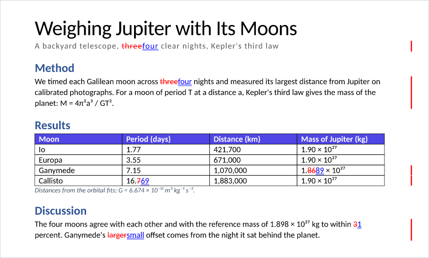
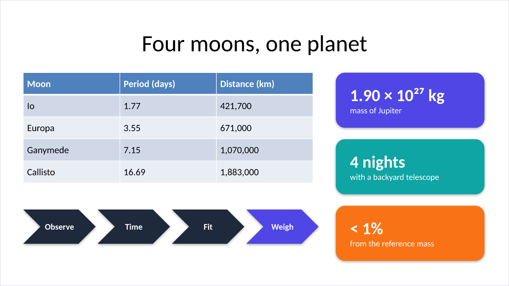

<div align="center">


# rdocx-skills

**Word and PowerPoint skills for AI agents: read, write, edit, review and render `.docx` and `.pptx` files
with native, hash-pinned tools.**

[](https://github.com/hadim/rdocx-skills/actions/workflows/ci.yml)
[](https://github.com/hadim/rdocx-skills/releases/latest)
[](https://github.com/hadim/rdocx-skills/blob/main/LICENSE)
[](https://github.com/hadim/rdocx-skills/blob/main/docs/setup.md)
[](https://github.com/tensorbee/rdocx)

</div>

|  |  |
|:---:|:---:|
| 📝 A redline of two versions of a lab report, rendered by rdocx in reviewer colours | 📊 A slide built and rendered by rpptx |

<p align="center"><sub>Both pictures come straight out of rdocx and rpptx: no Word, no PowerPoint, no LibreOffice.</sub></p>

Give your agent real Office skills. This plugin teaches it to work on Word and PowerPoint files through
[rdocx](https://github.com/tensorbee/rdocx) and rpptx, native Rust CLIs with Python bindings, instead of
LibreOffice round trips, python-docx, python-pptx or hand-written XML.

## ✨ Why rdocx-skills

- ⚡ **Native and fast**: one CLI call for whole-file work, the Python binding for anything finer. No office
  suite to install.
- 🎯 **Loads by itself**: the skills step in as soon as a `.docx` or `.pptx` shows up, even when you don't
  name a tool.
- 🖨️ **Faithful rendering**: PDF and PNG from rdocx's own layout engine, built to match what Word and
  PowerPoint draw.
- ⚛️ **Atomic edits**: every edit declares how many places it changes and applies all of them or none; a file
  is saved through a temporary copy, renamed only once complete, and never over its input.
- 🔒 **Verified supply chain**: every binary is pinned by SHA-256 and checked before it runs.
- 🧪 **Tested on four platforms**: an acceptance suite runs every recipe of the skills on each change.

## 🚀 Quick start

In Claude Code:

```
/plugin marketplace add hadim/rdocx-skills
/plugin install rdocx@rdocx-skills
```

Then ask in plain words, for example:

- 💬 *"Summarise the tracked changes in `paper-v2.docx` and accept the typo fixes."*
- 💬 *"Redline `report-v1.docx` against `report-v2.docx` and save the result as a PDF."*
- 💬 *"Fill `template.docx` with the rows of `data.csv`."*
- 💬 *"Turn these notes into a ten-slide deck and check that no text overflows its box."*
- 💬 *"Reply to every open comment in `review.pptx` and export the deck to Markdown."*

The first time a skill runs, it installs the pinned build for your machine in a few seconds (see
[What the plugin downloads and runs](#-what-the-plugin-downloads-and-runs)).

## 🧰 What your agent can do

rdocx and rpptx cover most of what Word and PowerPoint files hold. The skills point the agent at the right
call for each task.

### 📖 Read and extract

- 📄 Text of the body, tables, headers, footers, footnotes, text boxes and comments, also as JSON
- 🔎 Where a string occurs, the page each block lands on, the styles used, the metadata
- 🗂️ Slide text with its structure and formatting, titles and outline, speaker notes and comments

### ✍️ Create and edit

- 🆕 New documents from scratch, from Markdown or HTML, or from a `.dotx` or `.potx` template
- 🧩 Templates and forms filled from data: `{{ fields }}`, loops, content controls and legacy form fields
- 🔁 Counted find and replace, regular expressions included, across runs and without losing the formatting
- 🎨 Paragraphs, headings, lists, styles and numbering; tables with merges, borders and shading; page setup
- 🖼️ Pictures, hyperlinks, charts, equations from a subset of LaTeX, headers, footers and page numbers
- 🔷 Shapes, connectors, fills, lines, shadows, groups and z-order; themes, masters and layouts
- 🗃️ Slides added, reordered, hidden, imported or removed; decks merged; documents combined

### 💬 Review and collaborate

- 🗨️ Comments with replies and resolution, anchored on exact text or on a shape
- ✅ Tracked changes listed, accepted or rejected: all of them, or by id, author or date
- 🔀 A redline of two versions, word by word
- 📑 Tables of contents and page fields rebuilt; `rpptx diff` to see what changed between two decks
- 🔏 Documents and decks signed, and their signatures checked (certificate trust stays yours to judge)

### 🖨️ Render, convert and export

- 📄 PDF and PNG pages, with tracked changes shown in reviewer colours when asked; PDF/A, notes and handouts
- 🔄 Word to Markdown, HTML, ODT, RTF and EPUB; PowerPoint to Markdown and HTML
- 📏 Text-fit checks before a slide overflows, and validity checks before a file goes out
- 🔤 Fonts embedded, when their licence allows it

### 🛠️ When the API runs out

- 🧬 **Raw XML, safely**: paragraphs, runs, tables, shapes, text frames and slides expose their XML (`xml`,
  `replace_xml`), so an agent can still reach an Office feature that has no API yet, inside the same tool. The
  replacement is checked first, and a bad one changes nothing.
- 🩹 **Honest about gaps**: each skill lists the tool's known gaps with a workaround, or a hand-off to the
  built-in skills, and asks the agent to report any new one as a neutral reproduction.

## 🔒 What the plugin downloads and runs

The plugin itself holds no binaries. Here is everything it fetches and runs:

| | |
|---|---|
| ⬇️ **Downloads** | Once, the pinned rdocx and rpptx CLIs and wheels for your machine (about 45 MB), from this repository's GitHub release recorded in `rdocx.lock.json`. Nothing comes from PyPI. |
| ✅ **Verifies** | The SHA-256 of every file against the lock, before anything is installed; `status` checks them again. Without a verified build, the skills say so and hand the task to the built-in skills. |
| 📁 **Installs** | Under `~/.local/share/rdocx-skills/` (`RDOCX_HOME`), for your user only, nothing system-wide. |
| 🚫 **Sends** | Nothing. The tools run locally, and your documents never leave your machine. |

<details>
<summary>Two maintainer commands go further</summary>

The skills never run them on their own:

- `install --build` compiles the pinned commit from source: the commit from GitHub, crates from crates.io with
  `cargo --locked`, build tools from PyPI pinned by hash.
- `lock --write --release` downloads the files of the release the lock names and records their hashes.

</details>

### 🔐 Supply chain

- 📌 **The pin**: `rdocx.lock.json` names an upstream commit and, per platform, the SHA-256 of each CLI, each
  wheel and every file the wheels install.
- 📦 **The builds**: the plugin's releases are the only published builds. Each one builds the pinned commit, an
  upstream release as much as an integration branch, on four platforms, runs the acceptance suite on those files,
  attaches them with their `SHA256SUMS` and build provenance attestations, and its lock points at them. Its
  title says what it holds: `rdocx 0.16.1 · rpptx 0.14.1` for an upstream release, or `... + <ref>` for anything
  else. Only the latest release is kept.
- 🍴 **Integration branches** live on the maintainer's fork, [hadim/rdocx](https://github.com/hadim/rdocx): an
  upstream release plus the maintainer's pull requests still open on tensorbee/rdocx, pinned when the skills need
  a fix before upstream releases it. The lock's `upstream` and `ref` name the fork and the branch.
- 🧾 **Local builds**: every git object of the commit is verified, and `cargo --locked` builds it.

```bash
python3 plugin/scripts/rdocx_env.py install      # download the pinned files and verify them (or: install --build)
python3 plugin/scripts/rdocx_env.py test         # the acceptance suite on the installed build
python3 plugin/scripts/rdocx_env.py bump v0.16.1 # move the pin to an upstream tag or commit (docs/setup.md)
```

### 💻 Platforms

- 🐧 Linux x86_64 and arm64, glibc 2.35 or later
- 🍎 macOS on Apple silicon (Intel Macs: `install --build`)
- 🪟 Windows x86_64, from Git Bash

See [docs/setup.md](https://github.com/hadim/rdocx-skills/blob/main/docs/setup.md) for the details.

## 🧪 Acceptance suite

`tests/` checks, on every push and pull request, on Linux x86_64 and arm64, macOS arm64 and Windows x86_64:

- 📄 every vertical on synthetic fixtures generated from scratch: a survey report of about 13 pages with the
  traits of a Google Docs export edited in Word, and a 7-slide deck;
- 🧮 the two acceptance matrices, identity attributes and producer traits by operation;
- 🧷 a document with a token in every story: cells, content controls, tracked changes, text boxes, headers and
  footers, notes;
- 📚 every recipe of the skills, run as written, and the helper scripts;
- 🚧 each known gap as a strict expected failure (`tests/gaps.py`): when a new pin fixes it, the suite fails on
  purpose so that the skills are updated.

## 🔄 Releases and updates

- 🏷️ **Versions**: each release of the plugin is a CalVer version (`2026.10.15`) and a GitHub release titled with
  the rdocx and rpptx versions it pins. The skills, the tests and the pinned build move together.
- 🌿 **The `release` branch** is the repository's default branch and carries the released version: Claude Code,
  Claude Desktop and the Claude plugin directory follow it. Development happens on `main`, which moves ahead between
  releases; to try it, add the marketplace as `hadim/rdocx-skills#main`.
- 🔔 **Updates**: third-party marketplaces do not update by themselves. Turn on auto-update for `rdocx-skills` in
  `/plugin` (Marketplaces), or run `/plugin marketplace update rdocx-skills`.

## 🗂️ Repository layout

<details>
<summary>What lives where</summary>

| Path | Content |
|---|---|
| `.claude-plugin/` | the marketplace entry, pointing at `plugin/` |
| `plugin/` | the plugin, and only what it ships: |
| `plugin/.claude-plugin/` | the plugin manifest |
| `plugin/skills/docx/`, `plugin/skills/pptx/` | `SKILL.md`, `references/` (CLI, Python API, recipes, gaps, interoperability), `scripts/` (helpers usable as commands) |
| `plugin/scripts/` | `rdocx_env.py` (install, build, verify, test, bump) and the hash-pinned build requirements |
| `plugin/rdocx.lock.json` | the pinned build |
| `plugin/assets/` | the plugin icon and the pictures of this page |
| `.github/` | CI on every push (it builds the pinned commit), the release workflow of the plugin |
| `tests/` | acceptance suite, fixture generators, gap registry |
| `findings/` | gaps met in real use, as neutral reproductions, before they become tests and gap entries |
| `docs/` | setup, releases and maintenance |

</details>

## 🛡️ Privacy

The plugin collects nothing and sends none of your data anywhere: the tools run locally, and its only network
request is the one-time download of the pinned build from GitHub. See the
[privacy policy](https://github.com/hadim/rdocx-skills/blob/main/PRIVACY.md).

## 📜 License

MIT. rdocx itself is MIT or Apache-2.0. This plugin is an independent project built on rdocx.
