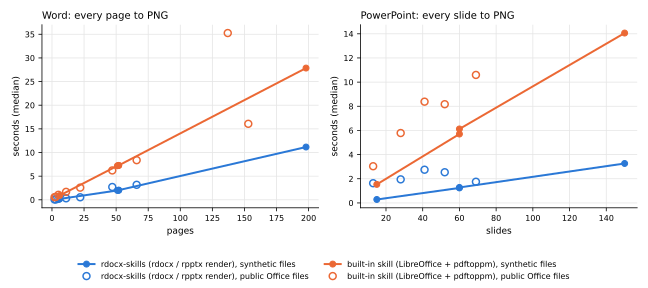
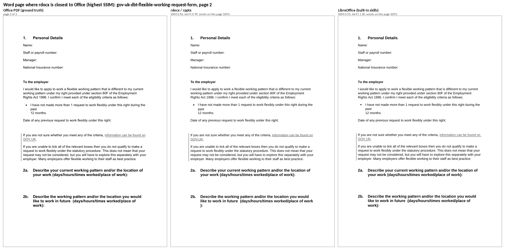
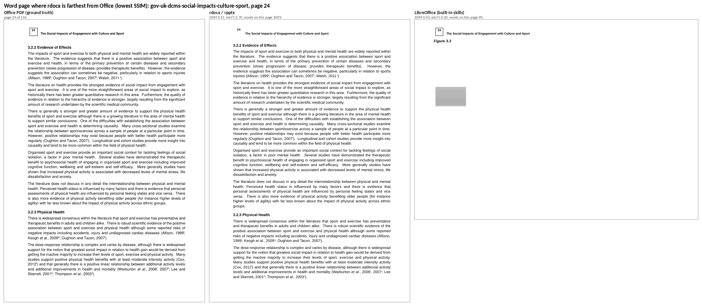
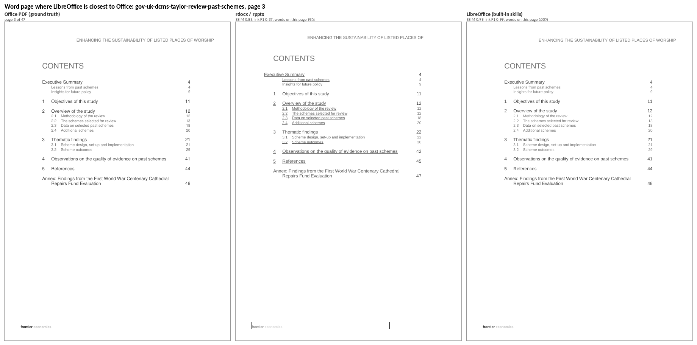
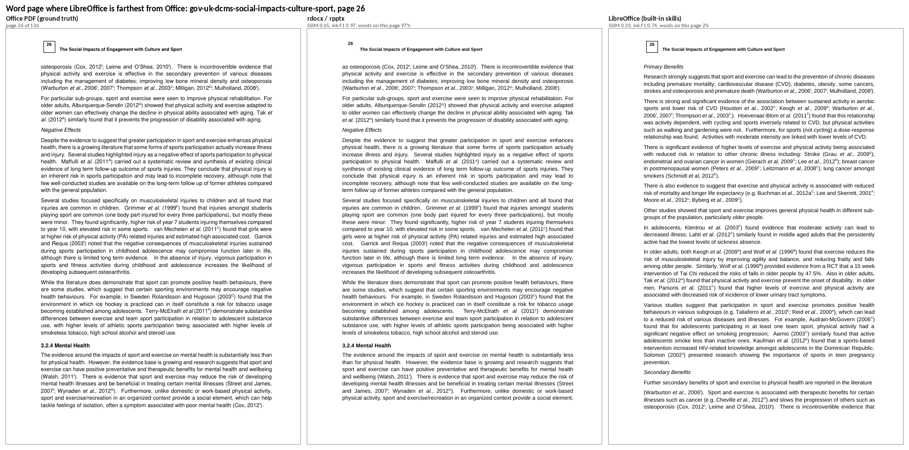
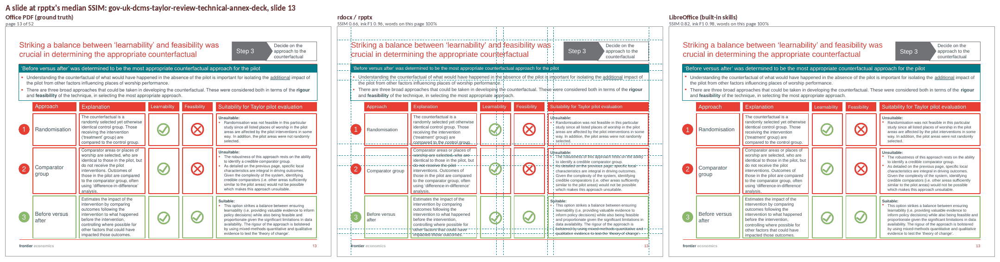
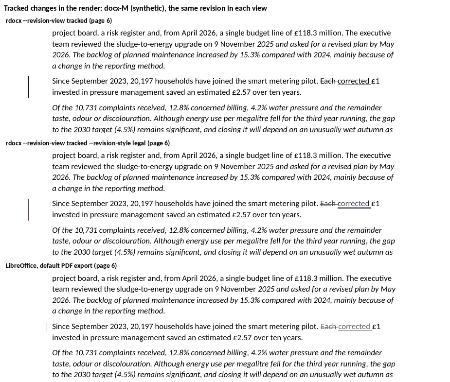
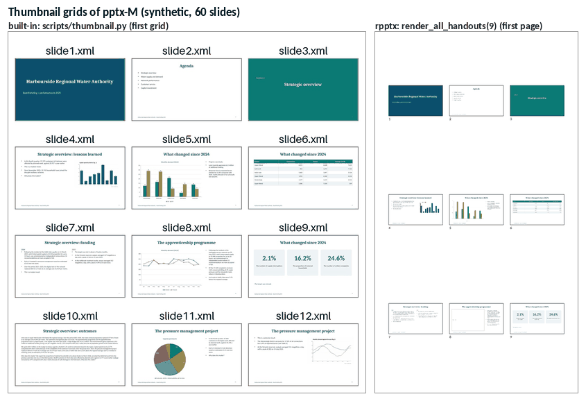

# 📊 Benchmark: rdocx-skills against Claude's built-in docx and pptx skills

<!-- bench:date:start -->
Run of 2026-11-01: rdocx 0.16.4 and rpptx 0.14.4 (pin `3707323312e9`) against the built-in skills (docx-js 9.15.0, pptxgenjs 4.0.1, LibreOffice 26.2.6.3, pandoc 3.13) and python-docx 1.2.0 / python-pptx 1.0.2.
<!-- bench:date:end -->

What does an agent gain, and lose, when it works on Word and PowerPoint files through rdocx-skills rather than
through Claude's built-in `docx` and `pptx` skills, or with python-docx and python-pptx alone? This folder
measures it on 44 tasks, 87 kinds of broken files, 23 realistic documents and decks, and the PDFs Word and
PowerPoint export themselves. Every number below is regenerated from `results/*.json` by `report.py`, and every
result can be rerun from scratch ([Reproduce](#-reproduce)).

The tools move fast: read the date above before quoting a number.

## 🏁 Scoreboard

<!-- bench:scoreboard:start -->
|  | Claude + rdocx-skills | Claude + built-in skill | Python libraries alone |
| --- | :---: | :---: | :---: |
| 🧰 Tasks done, out of 44 | **43** | 41 | 37 |
| ✍️ Lines of code an agent writes (34 tasks all three do) | **388** | 1600 | 1190 |
| 🧬 Tasks that need hand-written OOXML | **1** | 29 | 29 |
| 🛑 Known mistakes refused before a file is written | **80 %** | 3 % | 39 % |
| 🔎 Corrupt or invalid docx caught by the stack's checks | 87 % | **89 %** | 36 % |
| 🔎 Corrupt or invalid pptx caught by the stack's checks | **97 %** | 73 % | 39 % |
| ⚡ Every page of a 52-page Word report to PNG | **2.13 s** | 7.38 s | ➖ |
| ⚡ Every slide of a 60-slide deck to PNG | **1.34 s** | 5.81 s | ➖ |
| ✏️ Counted replacement in a 52-page Word report | 3.07 s | 0.44 s | **0.19 s** |
| 🏗️ Build a 52-page Word report from scratch | 13 s | **0.29 s** | 0.48 s |
| 🖨️ Word files with the same page count as Word's own PDF | 4 / 8 | **7 / 8** | ➖ |
<!-- bench:scoreboard:end -->

<sub>Best value of each row in bold. ➖: the stack has no way to do it. Lines of code: what an agent writes for
the task, on the tasks all three stacks complete. "Caught by the stack's checks": the share of broken files that
the checks each stack's workflow runs flag (rdocx-skills: `validate` and opening the file; built-in: `validate.py`,
LibreOffice and, for Word, pandoc; python-docx / python-pptx: opening the file).</sub>

**In short.** On this run, rdocx-skills completes the most tasks while making an agent write about a quarter of
the code and almost never raw OOXML. It refuses most known mistakes before a file is written, catches broken
files about as well as the built-in skill's schema validator on Word and better on PowerPoint, and renders pages
three to four times faster than LibreOffice. It is behind on three things, each with a finding for upstream: Word pages are
drawn less faithfully than LibreOffice draws them; on long Word files, edits through the Python helpers and
building a document from scratch are slower than with the other stacks (table cells above all); and a reply to a
comment gets no range of its own.

## 💡 What it changes for an agent

<!-- bench:value:start -->
| Your agent needs to... | Claude + rdocx-skills | Claude + built-in skill | Python libraries alone |
| --- | :--- | :--- | :--- |
| 🔀 Redline two versions of a Word file | `rdocx compare --granularity word`<br><sub>2 lines</sub> | a diff written by hand, emitted as `w:ins` / `w:del`<br><sub>86 lines · 🧬 raw XML</sub> | a diff written by hand, emitted as `w:ins` / `w:del`<br><sub>80 lines · 🧬 raw XML</sub> |
| ✅ Reject one reviewer's tracked changes | `rdocx revision reject --author`<br><sub>2 lines</sub> | the XML edited by hand<br><sub>42 lines · 🧬 raw XML</sub> | the XML edited by hand<br><sub>35 lines · 🧬 raw XML</sub> |
| 📑 Rebuild a stale table of contents | `rdocx toc rebuild`<br><sub>2 lines</sub> | LibreOffice for the page numbers, then the TOC rewritten in XML<br><sub>56 lines · 🧬 raw XML</sub> | ➖ no pagination |
| 💬 Comment on an exact phrase | `docx_ops.py comment`<br><sub>3 lines</sub> | `merge_runs.py`, `comment.py`, markers placed in the XML<br><sub>29 lines · 🧬 raw XML</sub> | `add_comment` on whole runs, runs split in XML<br><sub>30 lines · 🧬 raw XML</sub> |
| ✏️ Counted find and replace that keeps the formatting | `docx_ops.replace_batch`<br><sub>4 lines</sub> | `merge_runs.py`, an XML edit, zip<br><sub>41 lines · 🧬 raw XML</sub> | runs walked by hand<br><sub>38 lines</sub> |
| 📊 Insert a native chart in a Word file | `doc.add_chart(...)`<br><sub>13 lines</sub> | chart XML and its workbook written by hand<br><sub>83 lines · 🧬 raw XML</sub> | python-pptx's chart XML grafted with lxml<br><sub>36 lines · 🧬 raw XML</sub> |
| 🗂️ Bring slides over from another deck | `rpptx slide import`<br><sub>2 lines</sub> | every part, layout and relationship copied in XML<br><sub>113 lines · 🧬 raw XML</sub> | OPC parts and lxml<br><sub>48 lines · 🧬 raw XML</sub> |
| 🔁 Duplicate, move, delete and hide slides | `rpptx slide duplicate / move / remove / hide`<br><sub>13 lines</sub> | `add_slide.py`, `sldIdLst` edited, `clean.py`<br><sub>67 lines · 🧬 raw XML</sub> | deep copies and lxml (no API)<br><sub>30 lines · 🧬 raw XML</sub> |
| 🔢 Slide numbers and a footer on every slide | `rpptx footer`<br><sub>2 lines</sub> | placeholders copied in XML<br><sub>46 lines · 🧬 raw XML</sub> | placeholders cloned, the field in lxml<br><sub>22 lines · 🧬 raw XML</sub> |
| 📏 Find text that overflows its box | `rpptx fit`<br><sub>9 lines</sub> | render the deck and look<br><sub>80 lines · 🧬 raw XML · ⚠️ partly</sub> | an estimator written by hand<br><sub>71 lines · 🧬 raw XML · ⚠️ partly</sub> |
| 🖼️ See a page as a picture | `rdocx render --pages 1`<br><sub>3 lines</sub> | LibreOffice to PDF, then pdftoppm<br><sub>8 lines</sub> | ➖ no renderer |
<!-- bench:value:end -->

<sub>The code an agent writes for each task with each stack, checked by the same oracle (section 1 has all 44
tasks). 🧬: OOXML written or edited by hand.</sub>

## 🥊 The three stacks

| | What it is | How an agent uses it |
|---|---|---|
| **Claude + rdocx-skills** | This plugin: the pinned [rdocx](https://github.com/tensorbee/rdocx) and rpptx build, native Rust CLIs with Python bindings, and the helpers `docx_ops.py` / `pptx_ops.py` | One CLI call for whole-file work, the Python binding for anything finer; renders pages itself |
| **Claude + built-in skill** | Claude's own `docx` and `pptx` skills, what Claude uses without this plugin | docx-js and pptxgenjs (npm) to create; unzip, edit the XML, zip to edit, with the skills' helper scripts (`merge_runs.py`, `comment.py`, `accept_changes.py`, `add_slide.py`, `clean.py`, `slide_text.py`, `thumbnail.py`, `office/validate.py`); pandoc to read Word files; LibreOffice and pdftoppm to render |
| **Python libraries alone** | python-docx and python-pptx, lxml where they have no API | What an agent writes with no skill, and the path the built-in pptx skill mentions. Also what ChatGPT does as far as third-party reviews describe it: it writes and runs python-docx or python-pptx code in its code interpreter (OpenAI documents no method of its own). Fast, as everything runs in one Python process, but it has no renderer, no validator and no API for tracked changes |

The built-in skills' scripts are proprietary: the benchmark calls them where Claude Code installs them and never
copies them. They carry no version number, so each run records a SHA-256 of their files (`Versions` below).

## 🧰 1. What an agent can do, and how much code it takes

Each task has one implementation per stack, written the way that stack's skill tells an agent to work, and one
neutral oracle (`zipfile` and `lxml` only) that decides whether the output does what was asked. Every output is
also run through `rdocx validate`, the built-in `validate.py` and a LibreOffice conversion.

<!-- bench:features-summary:start -->
| 44 tasks | Claude + rdocx-skills | Claude + built-in skill | Python libraries alone |
| --- | :---: | :---: | :---: |
| ✅ Done (oracle passes) | **43 / 44** | 41 / 44 | 37 / 44 |
| ⚠️ Partly done | 0 | 1 | 1 |
| ❌ Attempted, wrong result | 1 | 2 | **0** |
| ➖ Not possible with the stack | **0** | **0** | 6 |
| ✍️ Lines of code, the 34 tasks all three pass | **388** | 1600 | 1190 |
| ✍️ Lines of code per task (median) | **9** | 41.5 | 34 |
| 🧬 Tasks that need hand-written OOXML | **1** | 29 | 29 |
| 🔧 Commands per task (median) | **1** | 4 | **1** |
<!-- bench:features-summary:end -->

<details>
<summary>Every task</summary>

<!-- bench:features-matrix:start -->
✅ done · ⚠️ partly · ❌ wrong result · ➖ not possible · the number is the lines of code an agent writes · 🧬 hand-written OOXML

**Word: create and edit**

| Task | Claude + rdocx-skills | Claude + built-in skill | Python libraries alone |
| --- | :--- | :--- | :--- |
| D01 Create a report | ✅ 37 | ✅ 53 | ✅ 60 🧬 |
| D02 Read every story | ✅ 14 | ✅ 51 | ✅ 38 |
| D03 Counted replacement | ✅ 4 | ✅ 41 🧬 | ✅ 38 |
| D04 Fill a template | ✅ 15 | ✅ 27 🧬 | ✅ 34 🧬 |
| D05 Edit a table | ✅ 14 | ✅ 46 🧬 | ✅ 25 🧬 |
| D06 Page setup of two sections | ✅ 13 | ✅ 46 🧬 | ✅ 34 🧬 |
| D07 Insert and replace pictures | ✅ 11 | ✅ 40 🧬 | ✅ 12 🧬 |
| D08 Insert a native chart | ✅ 13 | ✅ 83 🧬 | ✅ 36 🧬 |
| D09 Insert an equation | ✅ 11 | ✅ 20 🧬 | ✅ 15 🧬 |
| D10 Add hyperlinks | ✅ 15 | ✅ 32 🧬 | ✅ 32 🧬 |
| D11 Add a footnote | ✅ 10 | ✅ 35 🧬 | ✅ 37 🧬 |
| D12 Custom style and list restart | ✅ 15 | ✅ 33 🧬 | ✅ 23 🧬 |
| D13 Markdown to Word | ✅ 14 | ✅ 2 | ✅ 64 🧬 |
| D14 Word to Markdown | ✅ 2 | ✅ 2 | ✅ 47 |

**Word: review, layout and render**

| Task | Claude + rdocx-skills | Claude + built-in skill | Python libraries alone |
| --- | :--- | :--- | :--- |
| R01 Comment on a phrase split across runs | ✅ 3 | ✅ 29 🧬 | ✅ 30 🧬 |
| R02 Reply to a comment and resolve the thread | ❌ 8 | ✅ 33 🧬 | ✅ 34 🧬 |
| R03 List comments with their anchored text | ✅ 7 | ✅ 58 | ✅ 22 🧬 |
| R04 Replace a word as a tracked change | ✅ 5 | ✅ 20 🧬 | ✅ 42 🧬 |
| R05 List tracked changes | ✅ 19 🧬 | ❌ 30 | ✅ 22 🧬 |
| R06 Accept all tracked changes | ✅ 2 | ✅ 2 | ✅ 41 🧬 |
| R07 Reject the changes of one author | ✅ 2 | ✅ 42 🧬 | ✅ 35 🧬 |
| R08 Word-level redline of two versions | ✅ 2 | ✅ 86 🧬 | ✅ 80 🧬 |
| R09 Update a stale table of contents | ✅ 2 | ✅ 56 🧬 | ➖ |
| R10 Update PAGE, NUMPAGES and DATE fields | ✅ 2 | ✅ 42 🧬 | ➖ |
| R11 Render pages 1-3 to PNG (accepted and tracked views) | ✅ 3 | ✅ 8 | ➖ |
| R12 Page number of each heading | ✅ 11 | ✅ 21 | ➖ |
| R13 Convert to PDF (accepted and tracked views) | ✅ 4 | ✅ 6 | ➖ |
| R14 Which paragraphs differ between two versions | ✅ 9 | ✅ 20 | ✅ 25 |
| R15 Append a document with its own styles, picture and numbering | ✅ 6 | ✅ 101 🧬 | ✅ 78 🧬 |

**PowerPoint**

| Task | Claude + rdocx-skills | Claude + built-in skill | Python libraries alone |
| --- | :--- | :--- | :--- |
| P01 Create a 10-slide structured deck | ✅ 53 | ✅ 73 | ✅ 71 🧬 |
| P02 Read a deck into JSON | ✅ 17 | ✅ 23 | ✅ 21 |
| P03 Counted replace across slides and notes | ✅ 2 | ✅ 45 🧬 | ✅ 38 |
| P04 Duplicate, move, delete and hide slides | ✅ 13 | ✅ 67 🧬 | ✅ 30 🧬 |
| P05 Merge slides from another deck keeping their look | ✅ 2 | ✅ 113 🧬 | ✅ 48 🧬 |
| P06 Report overflowing text frames | ✅ 9 (P 1.00, R 1.00) | ⚠️ 80 🧬 (P 0.83, R 1.00) | ⚠️ 71 🧬 (P 0.83, R 1.00) |
| P07 Comment anchored to a shape, then a reply | ✅ 15 | ✅ 67 🧬 | ✅ 37 🧬 |
| P08 Change a chart's data | ✅ 11 | ✅ 54 🧬 | ✅ 11 |
| P09 Replace a picture keeping its frame | ✅ 7 | ✅ 38 🧬 | ✅ 11 🧬 |
| P10 Table: add a row, merge cells, fill a cell | ✅ 13 | ✅ 47 🧬 | ✅ 14 🧬 |
| P11 Set and change speaker notes | ✅ 9 | ✅ 75 🧬 | ✅ 9 |
| P12 Render every slide to PNG at 100 dpi | ✅ 2 | ✅ 6 | ➖ |
| P13 Export the deck to Markdown | ✅ 2 | ❌ 21 | ✅ 28 |
| P14 Slide numbers and footer as the Header and Footer dialog does | ✅ 2 | ✅ 46 🧬 | ✅ 22 🧬 |
| P15 Fill a .potx template | ✅ 20 | ✅ 83 🧬 | ✅ 30 🧬 |
<!-- bench:features-matrix:end -->

P06 is partial for all three stacks: each flags a table cell taller than its stored row height, which
PowerPoint simply grows. Method, judgement calls and per-task notes: `features/docx/NOTES_authoring.md`,
`features/docx/NOTES_review.md`, `features/pptx/NOTES.md`.

</details>

## 🛡️ 2. Catching broken files

**Detection.** Each of 43 Word and 44 PowerPoint mutations (a truncated ZIP, a relationship to a missing part,
elements out of schema order, a dangling comment id, the faults pptxgenjs is known to write...) is applied to
valid files from each generator. The ground truth is the specification, ECMA-376 Parts 1 and 2, checked by an
oracle on the official schemas; negative controls are valid files with legal but unusual content.

<!-- bench:validity-detection:start -->
**docx**

| Checker | Invalid files caught | zip | package | XML | schema | references | False alarms: valid controls | False alarms: untouched Office files |
| --- | :---: | :---: | :---: | :---: | :---: | :---: | :---: | :---: |
| `rdocx validate` | **87 %** | 6/6 | 14/14 | 8/8 | 16/20 | 8/12 | 2/24 | 0/9 |
| built-in `validate.py` | 84 % | 4/6 | 12/14 | 8/8 | 18/20 | 8/12 | 0/24 | 2/9 |
| python-docx opens it | 36 % | 6/9 | 15/21 | 9/12 | 0/30 | 3/18 | 3/36 | 0/9 |
| LibreOffice converts it | 34 % | 9/9 | 9/21 | 9/12 | 0/30 | 5/18 | 0/36 | 0/9 |
| pandoc reads it | 13 % | 6/9 | 3/21 | 3/12 | 0/30 | 0/18 | 0/36 | – |

**pptx**

| Checker | Invalid files caught | zip | package | XML | schema | references | False alarms: valid controls | False alarms: untouched Office files |
| --- | :---: | :---: | :---: | :---: | :---: | :---: | :---: | :---: |
| `rpptx validate` | **94 %** | 6/6 | 12/14 | 8/8 | 21/21 | 10/12 | 0/22 | 0/5 |
| built-in `validate.py` | 70 % | 6/9 | 18/21 | 12/12 | 15/31 | 15/18 | 0/33 | 2/5 |
| python-pptx opens it | 39 % | 6/9 | 13/21 | 9/12 | 0/31 | 9/18 | 3/33 | 0/5 |
| LibreOffice converts it | 16 % | 6/9 | 6/21 | 3/12 | 0/31 | 0/18 | 0/33 | 0/5 |
<!-- bench:validity-detection:end -->

<sub>zip / package / XML / schema / references: invalid files caught per layer. "Untouched Office files": the
public files of the corpus, as Word and PowerPoint saved them. rdocx's two are the reports it refuses to open
(duplicate bookmark ids, a finding); validate.py's are Word charts and PowerPoint parts its schema set does not
know.</sub>

**Prevention.** The mistakes the built-in skills document for docx-js and pptxgenjs ('#' in a colour, 8-digit
hex, negative shadow offsets, labels a stacked chart refuses, '&' in a layout name...), and their analogues for
the other libraries (bare integers where a length is due, negative sizes, malformed XML through `replace_xml`, a
replacement with the wrong count, an unknown style...):

<!-- bench:validity-prevention:start -->
| Generator | Stack | Mistakes tried | Refused at the call | Wrote an invalid file | Wrote a valid file, silently different | Harmless (same as the right call) |
| --- | :---: | :---: | :---: | :---: | :---: | :---: |
| rdocx | rdocx-skills | 15 | 🛑 13 | 💥 0 | 🤫 0 | 2 |
| rpptx | rdocx-skills | 15 | 🛑 11 | 💥 0 | 🤫 3 | 1 |
| python-docx | no skill | 10 | 🛑 5 | 💥 2 | 🤫 3 | 0 |
| python-pptx | no skill | 8 | 🛑 2 | 💥 3 | 🤫 3 | 0 |
| docx-js | built-in skill | 12 | 🛑 1 | 💥 3 | 🤫 6 | 2 |
| pptxgenjs | built-in skill | 18 | 🛑 0 | 💥 10 | 🤫 6 | 2 |
<!-- bench:validity-prevention:end -->

**A save that fails half-way** (a 4 KB file size limit stands in for a full disk):

<!-- bench:validity-atomic:start -->
| Stack | Format | Save that fails half-way (disk full) | File it was writing over |
| --- | :---: | --- | --- |
| rdocx | docx | Document.save over the input | ✅ intact |
| rdocx | docx | docx_ops.save_atomic(doc, out, src) over an existing output | ✅ intact |
| rdocx | pptx | Presentation.save over the input | ✅ intact |
| rdocx | pptx | pptx_ops.save_atomic(prs, out, src) over an existing output | ✅ intact |
| pylib | docx | python-docx Document.save over the input | 💥 replaced by a smaller package that opens as a ZIP (4096 bytes) but breaks 11 rule(s), e.g. opc: _rels/.rels rId2 targets missing part docProps/thumbnail.jpeg |
| pylib | pptx | python-pptx Presentation.save over the input | 💥 corrupt (4096 bytes: zip: not a readable ZIP archive (File is not a zip file)) |
| builtin | docx | docx-js Packer.toBuffer + fs.writeFileSync over an existing output | 💥 corrupt (4096 bytes: zip: not a readable ZIP archive (File is not a zip file)) |
| builtin | pptx | pptxgenjs writeFile over an existing output | 💥 corrupt (4096 bytes: zip: not a readable ZIP archive (File is not a zip file)) |
| builtin | docx | built-in edit flow: rm -f ../out.docx && zip -Xr ../out.docx . (over an existing output) | 💥 missing |
<!-- bench:validity-atomic:end -->

Method, label sources and every mutation: `validity/NOTES.md`.

## ⚡ 3. Speed on realistic files

Wall time of the command an agent runs, process start included: the median of 5 runs after a warm-up (3 for
LibreOffice and anything over 20 s), on a quiet machine. Each operation's output is checked (replacement count,
comment present, one PNG per page...). The rdocx rows of the five operations that go through the Python binding
(creation, counted replacement and comment, with and without validation) were measured again on pin `3707323312e9`;
every other row comes from the full run of 2026-10-31 on pin `b3be9b6db132` (same machine, the other stacks
unchanged; `remeasured` in `results/speed.json`).



<!-- bench:speed:start -->
**A 52-page Word report** (`docx-M`), median wall time of the command an agent runs

| Operation | Claude + rdocx-skills | Claude + built-in skill | Python libraries alone | rdocx-skills against the built-in skill |
| --- | :---: | :---: | :---: | :---: |
| 📖 Read all the text | 0.48 s | 0.44 s | **0.12 s** | ≈ same |
| ✏️ Counted replacement (the skill's helper) | 3.07 s | 0.44 s | **0.19 s** | 🐢 6.9× slower |
| 💬 Comment on a phrase | 3.07 s | 0.48 s | **0.09 s** | 🐢 6.4× slower |
| ✅ Accept all tracked changes | 1.23 s | **0.78 s** | ➖ | 🐢 1.6× slower |
| 🖼️ Page 1 to PNG | **0.84 s** | 1.20 s | ➖ | 🚀 1.4× faster |
| 🖼️ Every page to PNG | **2.13 s** | 7.38 s | ➖ | 🚀 3.5× faster |
| 📄 PDF | **1.07 s** | 1.15 s | ➖ | ≈ same |
| 📝 Markdown | **0.39 s** | 0.45 s | ➖ | ≈ same |
| 🔎 Validate | **0.27 s** | 0.40 s | ➖ | 🚀 1.5× faster |
| 🏗️ Build the document from scratch | 13 s | **0.29 s** | 0.48 s | 🐢 45× slower |

**A 60-slide deck** (`pptx-M`), median wall time of the command an agent runs

| Operation | Claude + rdocx-skills | Claude + built-in skill | Python libraries alone | rdocx-skills against the built-in skill |
| --- | :---: | :---: | :---: | :---: |
| 📖 Read text and notes | **0.11 s** | 0.13 s | 0.12 s | ≈ same |
| ✏️ Counted replacement | 0.24 s | **0.12 s** | 0.16 s | 🐢 2.1× slower |
| 🗂️ Duplicate a slide | 0.14 s | **0.10 s** | 0.14 s | 🐢 1.5× slower |
| 🖼️ Slide 1 to PNG | **0.68 s** | 1.68 s | ➖ | 🚀 2.5× faster |
| 🖼️ Every slide to PNG | **1.34 s** | 5.81 s | ➖ | 🚀 4.4× faster |
| 🧩 Thumbnails | **0.67 s** | 2.67 s | ➖ | 🚀 4.0× faster |
| 📄 PDF | **0.84 s** | 1.63 s | ➖ | 🚀 1.9× faster |
| 🔎 Validate | **0.17 s** | 0.37 s | ➖ | 🚀 2.2× faster |
| 🏗️ Build the deck from scratch | 2.34 s | **0.28 s** | 0.29 s | 🐢 8.3× slower |
<!-- bench:speed:end -->

<details>
<summary>Every file and every variant</summary>

<!-- bench:speed-details:start -->
| Operation | File | Median per variant |
| --- | --- | --- |
| docx.read | docx-S (6 pages) | rdocx: text --json 0.05 s; builtin: pandoc 0.08 s; builtin: xml (unzip + lxml) 0.03 s; pylib: python-docx 0.05 s |
| docx.read | docx-M-clean (51 pages) | rdocx: text --json 0.47 s; builtin: pandoc 0.42 s; builtin: xml (unzip + lxml) 0.07 s; pylib: python-docx 0.12 s |
| docx.read | docx-M (52 pages) | rdocx: text --json 0.48 s; builtin: pandoc 0.44 s; builtin: xml (unzip + lxml) 0.07 s; pylib: python-docx 0.12 s |
| docx.read | docx-M-lo (52 pages) | rdocx: text --json 0.31 s; builtin: pandoc 0.46 s; builtin: xml (unzip + lxml) 0.08 s; pylib: python-docx 0.12 s |
| docx.read | docx-L (198 pages) | rdocx: text --json 2.26 s; builtin: pandoc 1.63 s; builtin: xml (unzip + lxml) 0.20 s; pylib: python-docx 0.36 s |
| docx.read | gov-uk-dbt-flexible-working-request-form (3 pages) | rdocx: text --json 0.01 s; builtin: pandoc 0.03 s; builtin: xml (unzip + lxml) 0.03 s; pylib: python-docx 0.05 s |
| docx.read | data-gouv-ssmsi-cvs-note-presentation (5 pages) | rdocx: text --json 0.03 s; builtin: pandoc 0.07 s; builtin: xml (unzip + lxml) 0.03 s; pylib: python-docx 0.05 s |
| docx.read | gov-uk-pins-local-plan-webinar-qa (11 pages) | rdocx: text --json 0.06 s; builtin: pandoc 0.10 s; builtin: xml (unzip + lxml) 0.04 s; pylib: python-docx 0.05 s |
| docx.read | gov-uk-charity-commission-independent-examiner-template (2 pages) | rdocx: text --json 0.02 s; builtin: pandoc 0.05 s; builtin: xml (unzip + lxml) 0.03 s; pylib: python-docx 0.05 s |
| docx.read | gov-uk-dcms-creative-industries-consultation (22 pages) | rdocx: text --json 0.12 s; builtin: pandoc 0.18 s; builtin: xml (unzip + lxml) 0.04 s; pylib: python-docx 0.08 s |
| docx.read | gov-uk-dcms-taylor-review-past-schemes (47 pages) | rdocx: text --json 2.12 s; builtin: pandoc 0.70 s; builtin: xml (unzip + lxml) 0.16 s; pylib: python-docx 0.15 s |
| docx.read | gov-uk-dcms-taylor-review-interim-evaluation (66 pages) | rdocx: text --json 3.95 s; builtin: pandoc 0.73 s; builtin: xml (unzip + lxml) 0.16 s; pylib: python-docx 0.16 s |
| docx.read | gov-uk-dcms-social-impacts-culture-sport-appendices (153 pages) | rdocx: text --json 0.69 s; builtin: pandoc 0.90 s; builtin: xml (unzip + lxml) 0.15 s; pylib: python-docx 0.20 s |
| docx.read | gov-uk-dcms-social-impacts-culture-sport (137 pages) | rdocx: text --json 0.93 s; builtin: pandoc 0.77 s; builtin: xml (unzip + lxml) 0.22 s; pylib: python-docx 0.23 s |
| docx.replace | docx-S (6 pages) | rdocx: docx_ops replace 0.35 s; builtin: unzip/merge_runs/lxml/zip 0.10 s; rdocx: rdocx replace --expect 0.07 s; pylib: python-docx 0.06 s |
| docx.replace | docx-M-clean (51 pages) | rdocx: docx_ops replace 2.96 s; builtin: unzip/merge_runs/lxml/zip 0.44 s; rdocx: rdocx replace --expect 0.67 s; pylib: python-docx 0.18 s |
| docx.replace | docx-M (52 pages) | rdocx: docx_ops replace 3.07 s; builtin: unzip/merge_runs/lxml/zip 0.44 s; rdocx: rdocx replace --expect 0.69 s; pylib: python-docx 0.19 s |
| docx.replace | docx-M-lo (52 pages) | rdocx: docx_ops replace 2.15 s; builtin: unzip/merge_runs/lxml/zip 0.46 s; rdocx: rdocx replace --expect 0.48 s; pylib: python-docx 0.18 s |
| docx.replace | docx-L (198 pages) | rdocx: docx_ops replace 14 s; builtin: unzip/merge_runs/lxml/zip 1.85 s; rdocx: rdocx replace --expect 2.79 s; pylib: python-docx 0.62 s |
| docx.replace | gov-uk-dbt-flexible-working-request-form (3 pages) | rdocx: docx_ops replace 0.11 s; builtin: unzip/merge_runs/lxml/zip 0.07 s; rdocx: rdocx replace --expect 0.03 s; pylib: python-docx 0.05 s |
| docx.replace | data-gouv-ssmsi-cvs-note-presentation (5 pages) | rdocx: docx_ops replace 0.19 s; builtin: unzip/merge_runs/lxml/zip 0.10 s; rdocx: rdocx replace --expect 0.06 s; pylib: python-docx 0.08 s |
| docx.replace | gov-uk-pins-local-plan-webinar-qa (11 pages) | rdocx: docx_ops replace 0.36 s; builtin: unzip/merge_runs/lxml/zip 0.12 s; rdocx: rdocx replace --expect 0.07 s; pylib: python-docx 0.06 s |
| docx.replace | gov-uk-charity-commission-independent-examiner-template (2 pages) | rdocx: docx_ops replace 0.20 s; builtin: unzip/merge_runs/lxml/zip 0.08 s; rdocx: rdocx replace --expect 0.05 s; pylib: python-docx 0.05 s |
| docx.replace | gov-uk-dcms-creative-industries-consultation (22 pages) | rdocx: docx_ops replace 0.81 s; builtin: unzip/merge_runs/lxml/zip 0.18 s; rdocx: rdocx replace --expect 0.21 s; pylib: python-docx 0.09 s |
| docx.replace | gov-uk-dcms-taylor-review-past-schemes (47 pages) | rdocx: docx_ops replace 6.98 s; builtin: unzip/merge_runs/lxml/zip 1.43 s; rdocx: rdocx replace --expect 1.46 s; pylib: python-docx 0.30 s |
| docx.replace | gov-uk-dcms-taylor-review-interim-evaluation (66 pages) | rdocx: docx_ops replace 11 s; builtin: unzip/merge_runs/lxml/zip 1.39 s; rdocx: rdocx replace --expect 1.47 s; pylib: python-docx 0.32 s |
| docx.replace | gov-uk-dcms-social-impacts-culture-sport-appendices (153 pages) | rdocx: docx_ops replace 4.59 s; builtin: unzip/merge_runs/lxml/zip 1.22 s; rdocx: rdocx replace --expect 1.10 s; pylib: python-docx 0.38 s |
| docx.replace | gov-uk-dcms-social-impacts-culture-sport (137 pages) | rdocx: docx_ops replace 5.76 s; builtin: unzip/merge_runs/lxml/zip 1.46 s; rdocx: rdocx replace --expect 1.60 s; pylib: python-docx 0.83 s |
| docx.replace+validate | docx-S (6 pages) | rdocx: docx_ops replace+validate 0.38 s; builtin: unzip/merge_runs/lxml/zip+validate 0.26 s |
| docx.replace+validate | docx-M-clean (51 pages) | rdocx: docx_ops replace+validate 3.22 s; builtin: unzip/merge_runs/lxml/zip+validate 0.84 s |
| docx.replace+validate | docx-M (52 pages) | rdocx: docx_ops replace+validate 3.33 s; builtin: unzip/merge_runs/lxml/zip+validate 0.86 s |
| docx.replace+validate | docx-M-lo (52 pages) | rdocx: docx_ops replace+validate 2.32 s; builtin: unzip/merge_runs/lxml/zip+validate 0.94 s |
| docx.replace+validate | docx-L (198 pages) | rdocx: docx_ops replace+validate 15 s; builtin: unzip/merge_runs/lxml/zip+validate 3.31 s |
| docx.replace+validate | gov-uk-dbt-flexible-working-request-form (3 pages) | rdocx: docx_ops replace+validate 0.12 s; builtin: unzip/merge_runs/lxml/zip+validate 0.19 s |
| docx.replace+validate | data-gouv-ssmsi-cvs-note-presentation (5 pages) | rdocx: docx_ops replace+validate 0.21 s; builtin: unzip/merge_runs/lxml/zip+validate 0.23 s |
| docx.replace+validate | gov-uk-pins-local-plan-webinar-qa (11 pages) | rdocx: docx_ops replace+validate 0.40 s; builtin: unzip/merge_runs/lxml/zip+validate 0.28 s |
| docx.replace+validate | gov-uk-charity-commission-independent-examiner-template (2 pages) | rdocx: docx_ops replace+validate 0.22 s; builtin: unzip/merge_runs/lxml/zip+validate 0.22 s |
| docx.replace+validate | gov-uk-dcms-creative-industries-consultation (22 pages) | rdocx: docx_ops replace+validate 0.89 s; builtin: unzip/merge_runs/lxml/zip+validate 0.43 s |
| docx.replace+validate | gov-uk-dcms-taylor-review-past-schemes (47 pages) | rdocx: docx_ops replace+validate 7.55 s; builtin: unzip/merge_runs/lxml/zip+validate 2.44 s |
| docx.replace+validate | gov-uk-dcms-taylor-review-interim-evaluation (66 pages) | rdocx: docx_ops replace+validate 12 s; builtin: unzip/merge_runs/lxml/zip+validate 2.59 s |
| docx.replace+validate | gov-uk-dcms-social-impacts-culture-sport-appendices (153 pages) | rdocx: docx_ops replace+validate 5.05 s; builtin: unzip/merge_runs/lxml/zip+validate 2.26 s |
| docx.replace+validate | gov-uk-dcms-social-impacts-culture-sport (137 pages) | rdocx: docx_ops replace+validate 6.23 s; builtin: unzip/merge_runs/lxml/zip+validate 2.27 s |
| docx.comment | docx-S (6 pages) | rdocx: docx_ops comment 0.33 s; builtin: unzip/merge_runs/comment.py/markers/zip 0.14 s; rdocx: rdocx comment add --anchor 0.08 s; pylib: python-docx add_comment 0.05 s |
| docx.comment | docx-M-clean (51 pages) | rdocx: docx_ops comment 2.94 s; builtin: unzip/merge_runs/comment.py/markers/zip 0.48 s; rdocx: rdocx comment add --anchor 0.74 s; pylib: python-docx add_comment 0.09 s |
| docx.comment | docx-M (52 pages) | rdocx: docx_ops comment 3.07 s; builtin: unzip/merge_runs/comment.py/markers/zip 0.48 s; rdocx: rdocx comment add --anchor 0.76 s; pylib: python-docx add_comment 0.09 s |
| docx.comment | docx-M-lo (52 pages) | rdocx: docx_ops comment 2.10 s; builtin: unzip/merge_runs/comment.py/markers/zip 0.50 s; rdocx: rdocx comment add --anchor 0.48 s; pylib: python-docx add_comment 0.09 s |
| docx.comment | docx-L (198 pages) | rdocx: docx_ops comment 15 s; builtin: unzip/merge_runs/comment.py/markers/zip 1.87 s; rdocx: rdocx comment add --anchor 3.08 s; pylib: python-docx add_comment 0.25 s |
| docx.comment | gov-uk-dbt-flexible-working-request-form (3 pages) | rdocx: docx_ops comment 0.11 s; builtin: unzip/merge_runs/comment.py/markers/zip 0.11 s; rdocx: rdocx comment add --anchor 0.03 s; pylib: python-docx add_comment 0.05 s |
| docx.comment | data-gouv-ssmsi-cvs-note-presentation (5 pages) | rdocx: docx_ops comment 0.20 s; builtin: unzip/merge_runs/comment.py/markers/zip 0.14 s; rdocx: rdocx comment add --anchor 0.06 s; pylib: python-docx add_comment 0.05 s |
| docx.comment | gov-uk-pins-local-plan-webinar-qa (11 pages) | rdocx: docx_ops comment 0.33 s; builtin: unzip/merge_runs/comment.py/markers/zip 0.15 s; rdocx: rdocx comment add --anchor 0.08 s; pylib: python-docx add_comment 0.05 s |
| docx.comment | gov-uk-charity-commission-independent-examiner-template (2 pages) |  |
| docx.comment | gov-uk-dcms-creative-industries-consultation (22 pages) | rdocx: docx_ops comment 0.72 s; builtin: unzip/merge_runs/comment.py/markers/zip 0.22 s; rdocx: rdocx comment add --anchor 0.21 s; pylib: python-docx add_comment 0.06 s |
| docx.comment | gov-uk-dcms-taylor-review-past-schemes (47 pages) | rdocx: docx_ops comment 5.45 s; builtin: unzip/merge_runs/comment.py/markers/zip 1.45 s; rdocx: rdocx comment add --anchor 1.68 s; pylib: python-docx add_comment 0.23 s |
| docx.comment | gov-uk-dcms-taylor-review-interim-evaluation (66 pages) | rdocx: docx_ops comment 7.89 s; builtin: unzip/merge_runs/comment.py/markers/zip 1.42 s; rdocx: rdocx comment add --anchor 1.67 s; pylib: python-docx add_comment 0.23 s |
| docx.comment | gov-uk-dcms-social-impacts-culture-sport-appendices (153 pages) | rdocx: docx_ops comment 4.16 s; builtin: unzip/merge_runs/comment.py/markers/zip 1.24 s; rdocx: rdocx comment add --anchor 1.16 s; pylib: python-docx add_comment 0.23 s |
| docx.comment | gov-uk-dcms-social-impacts-culture-sport (137 pages) | rdocx: docx_ops comment 5.51 s; builtin: unzip/merge_runs/comment.py/markers/zip 1.50 s; rdocx: rdocx comment add --anchor 1.60 s; pylib: python-docx add_comment 0.70 s |
| docx.comment+validate | docx-S (6 pages) | rdocx: docx_ops comment+validate 0.36 s; builtin: unzip/merge_runs/comment.py/markers/zip+validate 0.42 s |
| docx.comment+validate | docx-M-clean (51 pages) | rdocx: docx_ops comment+validate 3.19 s; builtin: unzip/merge_runs/comment.py/markers/zip+validate 1.01 s |
| docx.comment+validate | docx-M (52 pages) | rdocx: docx_ops comment+validate 3.33 s; builtin: unzip/merge_runs/comment.py/markers/zip+validate 1.03 s |
| docx.comment+validate | docx-M-lo (52 pages) | rdocx: docx_ops comment+validate 2.27 s; builtin: unzip/merge_runs/comment.py/markers/zip+validate 1.10 s |
| docx.comment+validate | docx-L (198 pages) | rdocx: docx_ops comment+validate 16 s; builtin: unzip/merge_runs/comment.py/markers/zip+validate 3.45 s |
| docx.comment+validate | gov-uk-dbt-flexible-working-request-form (3 pages) | rdocx: docx_ops comment+validate 0.12 s; builtin: unzip/merge_runs/comment.py/markers/zip+validate 0.35 s |
| docx.comment+validate | data-gouv-ssmsi-cvs-note-presentation (5 pages) | rdocx: docx_ops comment+validate 0.22 s; builtin: unzip/merge_runs/comment.py/markers/zip+validate 0.39 s |
| docx.comment+validate | gov-uk-pins-local-plan-webinar-qa (11 pages) | rdocx: docx_ops comment+validate 0.37 s; builtin: unzip/merge_runs/comment.py/markers/zip+validate 0.44 s |
| docx.comment+validate | gov-uk-dcms-creative-industries-consultation (22 pages) | rdocx: docx_ops comment+validate 0.81 s; builtin: unzip/merge_runs/comment.py/markers/zip+validate 0.58 s |
| docx.comment+validate | gov-uk-dcms-taylor-review-past-schemes (47 pages) | rdocx: docx_ops comment+validate 6.00 s; builtin: unzip/merge_runs/comment.py/markers/zip+validate 2.60 s |
| docx.comment+validate | gov-uk-dcms-taylor-review-interim-evaluation (66 pages) | rdocx: docx_ops comment+validate 8.46 s; builtin: unzip/merge_runs/comment.py/markers/zip+validate 2.73 s |
| docx.comment+validate | gov-uk-dcms-social-impacts-culture-sport-appendices (153 pages) | rdocx: docx_ops comment+validate 4.62 s; builtin: unzip/merge_runs/comment.py/markers/zip+validate 2.40 s |
| docx.comment+validate | gov-uk-dcms-social-impacts-culture-sport (137 pages) | rdocx: docx_ops comment+validate 5.98 s; builtin: unzip/merge_runs/comment.py/markers/zip+validate 2.42 s |
| docx.accept | docx-S (6 pages) | rdocx: rdocx revision accept 0.13 s; builtin: accept_changes.py (LibreOffice) 0.40 s |
| docx.accept | docx-M (52 pages) | rdocx: rdocx revision accept 1.23 s; builtin: accept_changes.py (LibreOffice) 0.78 s |
| docx.accept | docx-M-lo (52 pages) | rdocx: rdocx revision accept 0.94 s; builtin: accept_changes.py (LibreOffice) 0.79 s |
| docx.accept | docx-L (198 pages) | rdocx: rdocx revision accept 4.99 s; builtin: accept_changes.py (LibreOffice) 2.31 s |
| docx.render | docx-S (6 pages) | rdocx: rdocx render 0.19 s; builtin: soffice.py + pdftoppm 0.92 s |
| docx.render | docx-M-clean (51 pages) | rdocx: rdocx render 2.08 s; builtin: soffice.py + pdftoppm 7.30 s |
| docx.render | docx-M (52 pages) | rdocx: rdocx render 2.13 s; builtin: soffice.py + pdftoppm 7.38 s |
| docx.render | docx-M-lo (52 pages) | rdocx: rdocx render 2.15 s; builtin: soffice.py + pdftoppm 7.37 s |
| docx.render | docx-L (198 pages) | rdocx: rdocx render 12 s; builtin: soffice.py + pdftoppm 28 s |
| docx.render | gov-uk-dbt-flexible-working-request-form (3 pages) | rdocx: rdocx render 0.08 s; builtin: soffice.py + pdftoppm 0.63 s |
| docx.render | data-gouv-ssmsi-cvs-note-presentation (5 pages) | rdocx: rdocx render 0.21 s; builtin: soffice.py + pdftoppm 1.06 s |
| docx.render | gov-uk-pins-local-plan-webinar-qa (11 pages) | rdocx: rdocx render 0.33 s; builtin: soffice.py + pdftoppm 1.70 s |
| docx.render | gov-uk-charity-commission-independent-examiner-template (2 pages) | rdocx: rdocx render 0.07 s; builtin: soffice.py + pdftoppm 0.56 s |
| docx.render | gov-uk-dcms-creative-industries-consultation (22 pages) | rdocx: rdocx render 0.55 s; builtin: soffice.py + pdftoppm 2.61 s |
| docx.render | gov-uk-dcms-taylor-review-past-schemes (47 pages) | rdocx: rdocx render 2.85 s; builtin: soffice.py + pdftoppm 6.28 s |
| docx.render | gov-uk-dcms-taylor-review-interim-evaluation (66 pages) | rdocx: rdocx render 3.39 s; builtin: soffice.py + pdftoppm 8.53 s |
| docx.render | gov-uk-dcms-social-impacts-culture-sport-appendices (153 pages) | rdocx: rdocx render 3.84 s; builtin: soffice.py + pdftoppm 16 s |
| docx.render | gov-uk-dcms-social-impacts-culture-sport (137 pages) | rdocx: rdocx render 8.46 s; builtin: soffice.py + pdftoppm 36 s |
| docx.render-page1 | docx-S (6 pages) | rdocx: rdocx render 0.09 s; builtin: soffice.py + pdftoppm 0.51 s |
| docx.render-page1 | docx-M-clean (51 pages) | rdocx: rdocx render 0.81 s; builtin: soffice.py + pdftoppm 1.16 s |
| docx.render-page1 | docx-M (52 pages) | rdocx: rdocx render 0.84 s; builtin: soffice.py + pdftoppm 1.20 s |
| docx.render-page1 | docx-M-lo (52 pages) | rdocx: rdocx render 0.90 s; builtin: soffice.py + pdftoppm 1.21 s |
| docx.render-page1 | docx-L (198 pages) | rdocx: rdocx render 6.95 s; builtin: soffice.py + pdftoppm 4.17 s |
| docx.render-page1 | gov-uk-dbt-flexible-working-request-form (3 pages) | rdocx: rdocx render 0.05 s; builtin: soffice.py + pdftoppm 0.51 s |
| docx.render-page1 | data-gouv-ssmsi-cvs-note-presentation (5 pages) | rdocx: rdocx render 0.09 s; builtin: soffice.py + pdftoppm 0.57 s |
| docx.render-page1 | gov-uk-pins-local-plan-webinar-qa (11 pages) | rdocx: rdocx render 0.11 s; builtin: soffice.py + pdftoppm 0.58 s |
| docx.render-page1 | gov-uk-charity-commission-independent-examiner-template (2 pages) | rdocx: rdocx render 0.06 s; builtin: soffice.py + pdftoppm 0.53 s |
| docx.render-page1 | gov-uk-dcms-creative-industries-consultation (22 pages) | rdocx: rdocx render 0.20 s; builtin: soffice.py + pdftoppm 0.74 s |
| docx.render-page1 | gov-uk-dcms-taylor-review-past-schemes (47 pages) | rdocx: rdocx render 1.89 s; builtin: soffice.py + pdftoppm 1.05 s |
| docx.render-page1 | gov-uk-dcms-taylor-review-interim-evaluation (66 pages) | rdocx: rdocx render 2.08 s; builtin: soffice.py + pdftoppm 1.66 s |
| docx.render-page1 | gov-uk-dcms-social-impacts-culture-sport-appendices (153 pages) | rdocx: rdocx render 1.18 s; builtin: soffice.py + pdftoppm 2.21 s |
| docx.render-page1 | gov-uk-dcms-social-impacts-culture-sport (137 pages) | rdocx: rdocx render 1.50 s; builtin: soffice.py + pdftoppm 19 s |
| docx.pdf | docx-S (6 pages) | rdocx: rdocx convert --to pdf 0.11 s; builtin: soffice.py --convert-to pdf 0.46 s |
| docx.pdf | docx-M-clean (51 pages) | rdocx: rdocx convert --to pdf 1.02 s; builtin: soffice.py --convert-to pdf 1.12 s |
| docx.pdf | docx-M (52 pages) | rdocx: rdocx convert --to pdf 1.07 s; builtin: soffice.py --convert-to pdf 1.15 s |
| docx.pdf | docx-M-lo (52 pages) | rdocx: rdocx convert --to pdf 1.19 s; builtin: soffice.py --convert-to pdf 1.15 s |
| docx.pdf | docx-L (198 pages) | rdocx: rdocx convert --to pdf 8.09 s; builtin: soffice.py --convert-to pdf 4.12 s |
| docx.pdf | gov-uk-dbt-flexible-working-request-form (3 pages) | rdocx: rdocx convert --to pdf 0.03 s; builtin: soffice.py --convert-to pdf 0.38 s |
| docx.pdf | data-gouv-ssmsi-cvs-note-presentation (5 pages) | rdocx: rdocx convert --to pdf 0.08 s; builtin: soffice.py --convert-to pdf 0.42 s |
| docx.pdf | gov-uk-pins-local-plan-webinar-qa (11 pages) | rdocx: rdocx convert --to pdf 0.11 s; builtin: soffice.py --convert-to pdf 0.45 s |
| docx.pdf | gov-uk-charity-commission-independent-examiner-template (2 pages) | rdocx: rdocx convert --to pdf 0.05 s; builtin: soffice.py --convert-to pdf 0.40 s |
| docx.pdf | gov-uk-dcms-creative-industries-consultation (22 pages) | rdocx: rdocx convert --to pdf 0.22 s; builtin: soffice.py --convert-to pdf 0.69 s |
| docx.pdf | gov-uk-dcms-taylor-review-past-schemes (47 pages) | rdocx: rdocx convert --to pdf 2.04 s; builtin: soffice.py --convert-to pdf 0.97 s |
| docx.pdf | gov-uk-dcms-taylor-review-interim-evaluation (66 pages) | rdocx: rdocx convert --to pdf 2.35 s; builtin: soffice.py --convert-to pdf 1.58 s |
| docx.pdf | gov-uk-dcms-social-impacts-culture-sport-appendices (153 pages) | rdocx: rdocx convert --to pdf 1.68 s; builtin: soffice.py --convert-to pdf 2.04 s |
| docx.pdf | gov-uk-dcms-social-impacts-culture-sport (137 pages) | rdocx: rdocx convert --to pdf 1.92 s; builtin: soffice.py --convert-to pdf 19 s |
| docx.markdown | docx-S (6 pages) | rdocx: rdocx convert --to md 0.04 s; builtin: pandoc -t markdown 0.08 s |
| docx.markdown | docx-M-clean (51 pages) | rdocx: rdocx convert --to md 0.38 s; builtin: pandoc -t markdown 0.42 s |
| docx.markdown | docx-M (52 pages) | rdocx: rdocx convert --to md 0.39 s; builtin: pandoc -t markdown 0.45 s |
| docx.markdown | docx-M-lo (52 pages) | rdocx: rdocx convert --to md 0.26 s; builtin: pandoc -t markdown 0.46 s |
| docx.markdown | docx-L (198 pages) | rdocx: rdocx convert --to md 1.84 s; builtin: pandoc -t markdown 1.63 s |
| docx.markdown | gov-uk-dbt-flexible-working-request-form (3 pages) | rdocx: rdocx convert --to md 0.01 s; builtin: pandoc -t markdown 0.03 s |
| docx.markdown | data-gouv-ssmsi-cvs-note-presentation (5 pages) | rdocx: rdocx convert --to md 0.02 s; builtin: pandoc -t markdown 0.07 s |
| docx.markdown | gov-uk-pins-local-plan-webinar-qa (11 pages) | rdocx: rdocx convert --to md 0.05 s; builtin: pandoc -t markdown 0.10 s |
| docx.markdown | gov-uk-charity-commission-independent-examiner-template (2 pages) | rdocx: rdocx convert --to md 0.02 s; builtin: pandoc -t markdown 0.04 s |
| docx.markdown | gov-uk-dcms-creative-industries-consultation (22 pages) | rdocx: rdocx convert --to md 0.09 s; builtin: pandoc -t markdown 0.18 s |
| docx.markdown | gov-uk-dcms-taylor-review-past-schemes (47 pages) | rdocx: rdocx convert --to md 1.94 s; builtin: pandoc -t markdown 0.70 s |
| docx.markdown | gov-uk-dcms-taylor-review-interim-evaluation (66 pages) | rdocx: rdocx convert --to md 3.79 s; builtin: pandoc -t markdown 0.74 s |
| docx.markdown | gov-uk-dcms-social-impacts-culture-sport-appendices (153 pages) | rdocx: rdocx convert --to md 0.55 s; builtin: pandoc -t markdown 0.90 s |
| docx.markdown | gov-uk-dcms-social-impacts-culture-sport (137 pages) | rdocx: rdocx convert --to md 0.78 s; builtin: pandoc -t markdown 0.77 s |
| docx.validate | docx-S (6 pages) | rdocx: rdocx validate 0.03 s; builtin: validate.py 0.14 s |
| docx.validate | docx-M-clean (51 pages) | rdocx: rdocx validate 0.25 s; builtin: validate.py 0.38 s |
| docx.validate | docx-M (52 pages) | rdocx: rdocx validate 0.27 s; builtin: validate.py 0.40 s |
| docx.validate | docx-M-lo (52 pages) | rdocx: rdocx validate 0.18 s; builtin: validate.py 0.42 s |
| docx.validate | docx-L (198 pages) | rdocx: rdocx validate 1.07 s; builtin: validate.py 1.32 s |
| docx.validate | gov-uk-dbt-flexible-working-request-form (3 pages) | rdocx: rdocx validate 0.01 s; builtin: validate.py 0.12 s |
| docx.validate | data-gouv-ssmsi-cvs-note-presentation (5 pages) | rdocx: rdocx validate 0.02 s; builtin: validate.py 0.14 s |
| docx.validate | gov-uk-pins-local-plan-webinar-qa (11 pages) | rdocx: rdocx validate 0.04 s; builtin: validate.py 0.15 s |
| docx.validate | gov-uk-charity-commission-independent-examiner-template (2 pages) | rdocx: rdocx validate 0.02 s; builtin: validate.py 0.13 s |
| docx.validate | gov-uk-dcms-creative-industries-consultation (22 pages) | rdocx: rdocx validate 0.09 s; builtin: validate.py 0.23 s |
| docx.validate | gov-uk-dcms-taylor-review-past-schemes (47 pages) | rdocx: rdocx validate 0.57 s; builtin: validate.py 0.88 s |
| docx.validate | gov-uk-dcms-taylor-review-interim-evaluation (66 pages) | rdocx: rdocx validate 0.58 s; builtin: validate.py 0.89 s |
| docx.validate | gov-uk-dcms-social-impacts-culture-sport-appendices (153 pages) | rdocx: rdocx validate 0.45 s; builtin: validate.py 0.89 s |
| docx.validate | gov-uk-dcms-social-impacts-culture-sport (137 pages) | rdocx: rdocx validate 0.48 s; builtin: validate.py 0.76 s |
| pptx.read | pptx-S (15 slides) | rdocx: rpptx text --notes 0.03 s; builtin: slide_text.py 0.08 s; pylib: python-pptx 0.08 s |
| pptx.read | pptx-M-pythonpptx (60 slides) | rdocx: rpptx text --notes 0.07 s; builtin: slide_text.py 0.13 s; pylib: python-pptx 0.10 s |
| pptx.read | pptx-M (60 slides) | rdocx: rpptx text --notes 0.11 s; builtin: slide_text.py 0.13 s; pylib: python-pptx 0.12 s |
| pptx.read | pptx-L (150 slides) | rdocx: rpptx text --notes 0.30 s; builtin: slide_text.py 0.22 s; pylib: python-pptx 0.19 s |
| pptx.read | gov-uk-ukces-employer-skills-survey-2015-slide-pack (69 slides) | rdocx: rpptx text --notes 0.34 s; builtin: slide_text.py 0.27 s; pylib: python-pptx 0.22 s |
| pptx.read | gov-uk-ofqual-skills-employability-regulator-view (13 slides) | rdocx: rpptx text --notes 0.04 s; builtin: slide_text.py 0.09 s; pylib: python-pptx 0.09 s |
| pptx.read | gov-uk-ofqual-qualifications-reform-teachers (28 slides) | rdocx: rpptx text --notes 0.07 s; builtin: slide_text.py 0.10 s; pylib: python-pptx 0.10 s |
| pptx.read | gov-uk-dcms-taylor-review-technical-annex-deck (52 slides) | rdocx: rpptx text --notes 0.37 s; builtin: slide_text.py 0.23 s; pylib: python-pptx 0.22 s |
| pptx.read | gov-uk-ofsted-childminder-pre-registration-briefing (41 slides) | rdocx: rpptx text --notes 0.06 s; builtin: slide_text.py 0.10 s; pylib: python-pptx 0.10 s |
| pptx.replace | pptx-S (15 slides) | rdocx: rpptx replace --expect 0.04 s; builtin: zipfile/lxml/zip 0.06 s; pylib: python-pptx 0.09 s |
| pptx.replace | pptx-M-pythonpptx (60 slides) | rdocx: rpptx replace --expect 0.14 s; builtin: zipfile/lxml/zip 0.10 s; pylib: python-pptx 0.14 s |
| pptx.replace | pptx-M (60 slides) | rdocx: rpptx replace --expect 0.24 s; builtin: zipfile/lxml/zip 0.12 s; pylib: python-pptx 0.16 s |
| pptx.replace | pptx-L (150 slides) | rdocx: rpptx replace --expect 0.58 s; builtin: zipfile/lxml/zip 0.23 s; pylib: python-pptx 0.29 s |
| pptx.replace | gov-uk-ukces-employer-skills-survey-2015-slide-pack (69 slides) | rdocx: rpptx replace --expect 0.70 s; builtin: zipfile/lxml/zip 0.20 s; pylib: python-pptx 0.32 s |
| pptx.replace | gov-uk-ofqual-skills-employability-regulator-view (13 slides) | rdocx: rpptx replace --expect 0.09 s; builtin: zipfile/lxml/zip 0.09 s; pylib: python-pptx 0.12 s |
| pptx.replace | gov-uk-ofqual-qualifications-reform-teachers (28 slides) | rdocx: rpptx replace --expect 0.18 s; builtin: zipfile/lxml/zip 0.12 s; pylib: python-pptx 0.15 s |
| pptx.replace | gov-uk-dcms-taylor-review-technical-annex-deck (52 slides) | rdocx: rpptx replace --expect 0.77 s; builtin: zipfile/lxml/zip 0.25 s; pylib: python-pptx 0.36 s |
| pptx.replace | gov-uk-ofsted-childminder-pre-registration-briefing (41 slides) | rdocx: rpptx replace --expect 0.19 s; builtin: zipfile/lxml/zip 0.19 s; pylib: python-pptx 0.23 s |
| pptx.replace+validate | pptx-S (15 slides) | builtin: zipfile/lxml/zip+validate 0.25 s |
| pptx.replace+validate | pptx-M-pythonpptx (60 slides) | rdocx: rpptx replace --expect+validate 0.23 s; builtin: zipfile/lxml/zip+validate 0.46 s |
| pptx.replace+validate | pptx-M (60 slides) | builtin: zipfile/lxml/zip+validate 0.61 s |
| pptx.replace+validate | pptx-L (150 slides) | builtin: zipfile/lxml/zip+validate 1.34 s |
| pptx.replace+validate | gov-uk-ukces-employer-skills-survey-2015-slide-pack (69 slides) | rdocx: rpptx replace --expect+validate 1.32 s; builtin: zipfile/lxml/zip+validate 1.85 s |
| pptx.replace+validate | gov-uk-ofqual-skills-employability-regulator-view (13 slides) | rdocx: rpptx replace --expect+validate 0.17 s; builtin: zipfile/lxml/zip+validate 0.35 s |
| pptx.replace+validate | gov-uk-ofqual-qualifications-reform-teachers (28 slides) | rdocx: rpptx replace --expect+validate 0.29 s; builtin: zipfile/lxml/zip+validate 0.47 s |
| pptx.replace+validate | gov-uk-dcms-taylor-review-technical-annex-deck (52 slides) | rdocx: rpptx replace --expect+validate 1.51 s; builtin: zipfile/lxml/zip+validate 2.25 s |
| pptx.replace+validate | gov-uk-ofsted-childminder-pre-registration-briefing (41 slides) | rdocx: rpptx replace --expect+validate 0.31 s; builtin: zipfile/lxml/zip+validate 0.62 s |
| pptx.duplicate | pptx-S (15 slides) | rdocx: rpptx slide duplicate 0.03 s; builtin: add_slide.py -o 0.04 s; pylib: python-pptx + lxml copy 0.09 s |
| pptx.duplicate | pptx-M-pythonpptx (60 slides) | rdocx: rpptx slide duplicate 0.09 s; builtin: add_slide.py -o 0.09 s; pylib: python-pptx + lxml copy 0.12 s |
| pptx.duplicate | pptx-M (60 slides) | rdocx: rpptx slide duplicate 0.14 s; builtin: add_slide.py -o 0.10 s; pylib: python-pptx + lxml copy 0.14 s |
| pptx.duplicate | pptx-L (150 slides) | rdocx: rpptx slide duplicate 0.35 s; builtin: add_slide.py -o 0.20 s; pylib: python-pptx + lxml copy 0.23 s |
| pptx.duplicate | gov-uk-ukces-employer-skills-survey-2015-slide-pack (69 slides) | rdocx: rpptx slide duplicate 0.39 s; builtin: add_slide.py -o 0.17 s; pylib: python-pptx + lxml copy 0.27 s |
| pptx.duplicate | gov-uk-ofqual-skills-employability-regulator-view (13 slides) | rdocx: rpptx slide duplicate 0.07 s; builtin: add_slide.py -o 0.08 s; pylib: python-pptx + lxml copy 0.12 s |
| pptx.duplicate | gov-uk-ofqual-qualifications-reform-teachers (28 slides) | rdocx: rpptx slide duplicate 0.11 s; builtin: add_slide.py -o 0.10 s; pylib: python-pptx + lxml copy 0.14 s |
| pptx.duplicate | gov-uk-dcms-taylor-review-technical-annex-deck (52 slides) | rdocx: rpptx slide duplicate 0.46 s; builtin: add_slide.py -o 0.17 s; pylib: python-pptx + lxml copy 0.32 s |
| pptx.duplicate | gov-uk-ofsted-childminder-pre-registration-briefing (41 slides) | rdocx: rpptx slide duplicate 0.17 s; builtin: add_slide.py -o 0.18 s; pylib: python-pptx + lxml copy 0.22 s |
| pptx.fit | pptx-S (15 slides) | rdocx: rpptx fit --json 0.36 s; rdocx: pptx_ops.py overflow (text_layout) 0.17 s |
| pptx.fit | pptx-M-pythonpptx (60 slides) | rdocx: pptx_ops.py overflow (text_layout) 0.62 s |
| pptx.fit | pptx-M (60 slides) | rdocx: rpptx fit --json 1.45 s; rdocx: pptx_ops.py overflow (text_layout) 0.73 s |
| pptx.fit | pptx-L (150 slides) | rdocx: rpptx fit --json 4.14 s; rdocx: pptx_ops.py overflow (text_layout) 1.82 s |
| pptx.fit | gov-uk-ukces-employer-skills-survey-2015-slide-pack (69 slides) | rdocx: rpptx fit --json 1.29 s; rdocx: pptx_ops.py overflow (text_layout) 1.10 s |
| pptx.fit | gov-uk-ofqual-skills-employability-regulator-view (13 slides) | rdocx: rpptx fit --json 0.21 s; rdocx: pptx_ops.py overflow (text_layout) 1.36 s |
| pptx.fit | gov-uk-ofqual-qualifications-reform-teachers (28 slides) | rdocx: rpptx fit --json 1.53 s; rdocx: pptx_ops.py overflow (text_layout) 1.10 s |
| pptx.fit | gov-uk-dcms-taylor-review-technical-annex-deck (52 slides) | rdocx: pptx_ops.py overflow (text_layout) 1.61 s |
| pptx.fit | gov-uk-ofsted-childminder-pre-registration-briefing (41 slides) | rdocx: rpptx fit --json 0.93 s; rdocx: pptx_ops.py overflow (text_layout) 1.92 s |
| pptx.render | pptx-S (15 slides) | rdocx: rpptx render 0.30 s; builtin: soffice.py + pdftoppm 1.55 s |
| pptx.render | pptx-M-pythonpptx (60 slides) | rdocx: rpptx render 1.28 s; builtin: soffice.py + pdftoppm 6.25 s |
| pptx.render | pptx-M (60 slides) | rdocx: rpptx render 1.34 s; builtin: soffice.py + pdftoppm 5.81 s |
| pptx.render | pptx-L (150 slides) | rdocx: rpptx render 3.41 s; builtin: soffice.py + pdftoppm 14 s |
| pptx.render | gov-uk-ukces-employer-skills-survey-2015-slide-pack (69 slides) | rdocx: rpptx render 1.85 s; builtin: soffice.py + pdftoppm 11 s |
| pptx.render | gov-uk-ofqual-skills-employability-regulator-view (13 slides) | rdocx: rpptx render 1.83 s; builtin: soffice.py + pdftoppm 3.09 s |
| pptx.render | gov-uk-ofqual-qualifications-reform-teachers (28 slides) | rdocx: rpptx render 2.04 s; builtin: soffice.py + pdftoppm 5.84 s |
| pptx.render | gov-uk-dcms-taylor-review-technical-annex-deck (52 slides) | rdocx: rpptx render 2.48 s; builtin: soffice.py + pdftoppm 8.33 s |
| pptx.render | gov-uk-ofsted-childminder-pre-registration-briefing (41 slides) | rdocx: rpptx render 3.11 s; builtin: soffice.py + pdftoppm 8.49 s |
| pptx.render-slide1 | pptx-S (15 slides) | rdocx: rpptx render 0.15 s; builtin: soffice.py + pdftoppm 0.71 s |
| pptx.render-slide1 | pptx-M-pythonpptx (60 slides) | rdocx: rpptx render 0.56 s; builtin: soffice.py + pdftoppm 2.43 s |
| pptx.render-slide1 | pptx-M (60 slides) | rdocx: rpptx render 0.68 s; builtin: soffice.py + pdftoppm 1.68 s |
| pptx.render-slide1 | pptx-L (150 slides) | rdocx: rpptx render 1.71 s; builtin: soffice.py + pdftoppm 3.62 s |
| pptx.render-slide1 | gov-uk-ukces-employer-skills-survey-2015-slide-pack (69 slides) | rdocx: rpptx render 1.05 s; builtin: soffice.py + pdftoppm 5.34 s |
| pptx.render-slide1 | gov-uk-ofqual-skills-employability-regulator-view (13 slides) | rdocx: rpptx render 1.39 s; builtin: soffice.py + pdftoppm 1.40 s |
| pptx.render-slide1 | gov-uk-ofqual-qualifications-reform-teachers (28 slides) | rdocx: rpptx render 1.10 s; builtin: soffice.py + pdftoppm 1.39 s |
| pptx.render-slide1 | gov-uk-dcms-taylor-review-technical-annex-deck (52 slides) | rdocx: rpptx render 1.51 s; builtin: soffice.py + pdftoppm 2.61 s |
| pptx.render-slide1 | gov-uk-ofsted-childminder-pre-registration-briefing (41 slides) | rdocx: rpptx render 2.00 s; builtin: soffice.py + pdftoppm 3.34 s |
| pptx.thumbnail | pptx-S (15 slides) | rdocx: rpptx thumbnail (slide 1 only, not a grid) 0.15 s; builtin: thumbnail.py (grid) 0.93 s |
| pptx.thumbnail | pptx-M-pythonpptx (60 slides) | rdocx: rpptx thumbnail (slide 1 only, not a grid) 0.56 s; builtin: thumbnail.py (grid) 3.49 s |
| pptx.thumbnail | pptx-M (60 slides) | rdocx: rpptx thumbnail (slide 1 only, not a grid) 0.67 s; builtin: thumbnail.py (grid) 2.67 s |
| pptx.thumbnail | pptx-L (150 slides) | rdocx: rpptx thumbnail (slide 1 only, not a grid) 1.71 s; builtin: thumbnail.py (grid) 6.08 s |
| pptx.thumbnail | gov-uk-ukces-employer-skills-survey-2015-slide-pack (69 slides) | rdocx: rpptx thumbnail (slide 1 only, not a grid) 1.04 s; builtin: thumbnail.py (grid) 6.83 s |
| pptx.thumbnail | gov-uk-ofqual-skills-employability-regulator-view (13 slides) | rdocx: rpptx thumbnail (slide 1 only, not a grid) 1.28 s; builtin: thumbnail.py (grid) 1.91 s |
| pptx.thumbnail | gov-uk-ofqual-qualifications-reform-teachers (28 slides) | rdocx: rpptx thumbnail (slide 1 only, not a grid) 1.07 s; builtin: thumbnail.py (grid) 1.97 s |
| pptx.thumbnail | gov-uk-dcms-taylor-review-technical-annex-deck (52 slides) | rdocx: rpptx thumbnail (slide 1 only, not a grid) 1.50 s; builtin: thumbnail.py (grid) 3.80 s |
| pptx.thumbnail | gov-uk-ofsted-childminder-pre-registration-briefing (41 slides) | rdocx: rpptx thumbnail (slide 1 only, not a grid) 1.91 s; builtin: thumbnail.py (grid) 5.23 s |
| pptx.pdf | pptx-S (15 slides) | rdocx: rpptx convert --to pdf 0.18 s; builtin: soffice.py --convert-to pdf 0.65 s |
| pptx.pdf | pptx-M-pythonpptx (60 slides) | rdocx: rpptx convert --to pdf 0.72 s; builtin: soffice.py --convert-to pdf 2.35 s |
| pptx.pdf | pptx-M (60 slides) | rdocx: rpptx convert --to pdf 0.84 s; builtin: soffice.py --convert-to pdf 1.63 s |
| pptx.pdf | pptx-L (150 slides) | rdocx: rpptx convert --to pdf 2.12 s; builtin: soffice.py --convert-to pdf 3.59 s |
| pptx.pdf | gov-uk-ukces-employer-skills-survey-2015-slide-pack (69 slides) | rdocx: rpptx convert --to pdf 1.24 s; builtin: soffice.py --convert-to pdf 5.31 s |
| pptx.pdf | gov-uk-ofqual-skills-employability-regulator-view (13 slides) | rdocx: rpptx convert --to pdf 1.51 s; builtin: soffice.py --convert-to pdf 1.23 s |
| pptx.pdf | gov-uk-ofqual-qualifications-reform-teachers (28 slides) | rdocx: rpptx convert --to pdf 1.11 s; builtin: soffice.py --convert-to pdf 1.06 s |
| pptx.pdf | gov-uk-dcms-taylor-review-technical-annex-deck (52 slides) | rdocx: rpptx convert --to pdf 1.60 s; builtin: soffice.py --convert-to pdf 2.54 s |
| pptx.pdf | gov-uk-ofsted-childminder-pre-registration-briefing (41 slides) | rdocx: rpptx convert --to pdf 2.48 s; builtin: soffice.py --convert-to pdf 2.89 s |
| pptx.validate | pptx-S (15 slides) | rdocx: rpptx validate 0.04 s; builtin: validate.py 0.15 s |
| pptx.validate | pptx-M-pythonpptx (60 slides) | rdocx: rpptx validate 0.09 s; builtin: validate.py 0.26 s |
| pptx.validate | pptx-M (60 slides) | rdocx: rpptx validate 0.17 s; builtin: validate.py 0.37 s |
| pptx.validate | pptx-L (150 slides) | rdocx: rpptx validate 0.45 s; builtin: validate.py 0.77 s |
| pptx.validate | gov-uk-ukces-employer-skills-survey-2015-slide-pack (69 slides) | rdocx: rpptx validate 0.61 s; builtin: validate.py 1.13 s |
| pptx.validate | gov-uk-ofqual-skills-employability-regulator-view (13 slides) | rdocx: rpptx validate 0.08 s; builtin: validate.py 0.20 s |
| pptx.validate | gov-uk-ofqual-qualifications-reform-teachers (28 slides) | rdocx: rpptx validate 0.11 s; builtin: validate.py 0.25 s |
| pptx.validate | gov-uk-dcms-taylor-review-technical-annex-deck (52 slides) | rdocx: rpptx validate 0.73 s; builtin: validate.py 1.42 s |
| pptx.validate | gov-uk-ofsted-childminder-pre-registration-briefing (41 slides) | rdocx: rpptx validate 0.11 s; builtin: validate.py 0.26 s |
| docx.create | docx-S (None pages) | rdocx: rdocx Python (chapters + insert_document) 1.46 s; builtin: docx-js (corpus/gen_docx.js) 0.12 s; pylib: python-docx (+ lxml) 0.11 s; rdocx: rdocx Python naive (one body, cell handles) 1.56 s |
| docx.create | docx-M (None pages) | rdocx: rdocx Python (chapters + insert_document) 13 s; builtin: docx-js (corpus/gen_docx.js) 0.29 s; pylib: python-docx (+ lxml) 0.48 s |
| docx.create | docx-L (None pages) | rdocx: rdocx Python (chapters + insert_document) 91 s; builtin: docx-js (corpus/gen_docx.js) 0.75 s; pylib: python-docx (+ lxml) 1.93 s |
| pptx.create | pptx-S (None pages) | rdocx: rpptx Python 0.33 s; builtin: pptxgenjs + apply_theme.js (corpus/gen_pptx.js) 0.15 s; pylib: python-pptx (corpus/gen_pptx_pythonpptx.py) 0.14 s |
| pptx.create | pptx-M (None pages) | rdocx: rpptx Python 2.34 s; builtin: pptxgenjs + apply_theme.js (corpus/gen_pptx.js) 0.28 s; pylib: python-pptx (corpus/gen_pptx_pythonpptx.py) 0.29 s |
| pptx.create | pptx-L (None pages) | rdocx: rpptx Python 7.87 s; builtin: pptxgenjs + apply_theme.js (corpus/gen_pptx.js) 0.50 s; pylib: python-pptx (corpus/gen_pptx_pythonpptx.py) 0.67 s |
<!-- bench:speed-details:end -->

</details>

The counted replacement and the comment go through the skill's helpers (`docx_ops.replace_batch`,
`docx_ops.comment_on_text`), which check the edit on a copy first; the plain CLI (`rdocx replace --expect`,
`rdocx comment add`) is several times faster (the variants above). Method and caveats: `speed/NOTES.md`.

## 🖼️ 4. Visual feedback

What an agent can look at while it works, and how close the picture is to what Office itself draws.

<!-- bench:visual-capabilities:start -->
| What the agent can see | Claude + rdocx-skills | Claude + built-in skill | Python libraries alone |
| --- | :---: | :---: | :---: |
| One page or slide to PNG (docx) | ✅ | ✅ | ➖ |
| One page or slide to PNG (pptx) | ✅ | ✅ | ➖ |
| Only selected pages (docx) | ✅ | ✅ | ➖ |
| Only selected pages (pptx) | ✅ | ✅ | ➖ |
| Tracked changes shown in the render (docx) | ✅ | ✅ | ➖ |
| Comments shown in the render (docx) | ➖ | ⚠️ | ➖ |
| Thumbnail grid (pptx) | ✅ | ✅ | ➖ |
| Thumbnail grid (docx) | ➖ | ➖ | ➖ |
| Page of each heading or block (docx) | ✅ 9/13 right | ⚠️ 11/13 right | ⚠️ 7/13 right |
| Text-overflow report for slides (pptx) | ✅ | ➖ | ⚠️ |
| Warns when a font is substituted (docx) | ✅ | ➖ | ➖ |

<sub>"right": the heading's page agrees with Word's own PDF of the same file.</sub><br>
<sub>The overflow report works through the Python API, but `rpptx fit` (CLI) refused 2 of the 9 decks of the speed test (an rdocx finding).</sub><br>

Time to the first picture of page 1, one cold run

| File | Claude + rdocx-skills | Claude + built-in skill |
| --- | :---: | :---: |
| docx-L | 6.22 s | **3.95 s** |
| docx-M | **0.79 s** | 1.11 s |
| pptx-L | **1.65 s** | 3.45 s |
| pptx-M | **0.66 s** | 1.59 s |
<!-- bench:visual-capabilities:end -->

**Fidelity.** Public Word documents and decks were rendered by both stacks and compared with the PDF their
publisher exported from Word or PowerPoint: the page count, a structural similarity of the page images (SSIM, at
60 dpi) and where each word lands (`pdftotext -bbox`).

<!-- bench:visual-fidelity:start -->
| Files | Measure | Claude + rdocx-skills (rdocx / rpptx) | Claude + built-in skill (LibreOffice) |
| --- | --- | :---: | :---: |
| Word files, PDF exported by Word (8) | 📏 Same page count as Office | 4 / 8 | **7** / 8 |
|  | 🖼️ Page similarity (SSIM, median) | 0.60 | **0.80** |
|  | 🔤 Words on the same page as Office (median) | 86 % | **90 %** |
|  | 🎯 Words within 5 pt of Office's position (median) | 6 % | **34 %** |
| Deck, PDF exported by PowerPoint (1) | 📏 Same page count as Office | **1** / 1 | **1** / 1 |
|  | 🖼️ Page similarity (SSIM, median) | 0.77 | **0.82** |
|  | 🔤 Words on the same page as Office (median) | 93 % | **95 %** |
|  | 🎯 Words within 5 pt of Office's position (median) | 77 % | **89 %** |
| Decks, PDF from another producer (macOS, Acrobat) (4) | 📏 Same page count as Office | **4** / 4 | **4** / 4 |
|  | 🖼️ Page similarity (SSIM, median) | **0.86** | **0.86** |
|  | 🔤 Words on the same page as Office (median) | 92 % | **99 %** |
|  | 🎯 Words within 5 pt of Office's position (median) | **60 %** | 59 % |
<!-- bench:visual-fidelity:end -->

<details>
<summary>Side by side: Office's PDF, rdocx-skills, LibreOffice</summary>

<!-- bench:visual-figures:start -->

<sub>Word page where rdocx is closest to Office (highest SSIM): gov-uk-dbt-flexible-working-request-form, page 2</sub>


<sub>Word page where rdocx is farthest from Office (lowest SSIM): gov-uk-dcms-social-impacts-culture-sport, page 24</sub>


<sub>Word page where LibreOffice is closest to Office: gov-uk-dcms-social-impacts-culture-sport-appendices, page 88</sub>


<sub>Word page where LibreOffice is farthest from Office: gov-uk-dcms-social-impacts-culture-sport, page 26</sub>


<sub>Slide where rpptx scores its median SSIM (PowerPoint's own PDF): gov-uk-dcms-taylor-review-technical-annex-deck, page 13</sub>


<sub>The same tracked deletion in rdocx's tracked view (plain, legal) and LibreOffice's default export</sub>


<sub>Thumbnail grid of each stack for a 60-slide deck</sub>
<!-- bench:visual-figures:end -->

The figures show pages of public documents published by GOV.UK under the Open Government Licence v3.0
(attribution in `visual/NOTES.md`).

</details>

Method, metrics and per-document results: `visual/NOTES.md`.

## 🔬 Method

1. **Same inputs, same machine, same fonts.** Carlito and Caladea (metric-compatible with Calibri and Cambria)
   are given to both renderers: LibreOffice through `FONTCONFIG_FILE`, rdocx and rpptx through `--font-dir`.
2. **Idiomatic code for every stack.** Each implementation is what a competent agent following that stack's skill
   would write, with that stack's own helpers and its shortest documented path. No strawman: where a stack has a
   shorter way, it is the one measured.
3. **One neutral oracle per task** (`zipfile` and `lxml` only), which also runs every validator on the output.
4. **Status, not opinion.** Done when the oracle passes, wrong result when the stack's best attempt does not,
   not possible when the stack has no means short of a desktop Office application. Hand-written OOXML counts as
   possible, marked 🧬.
5. **Timing as an agent pays it**: wall time of the command, process start included, median of 5 runs.
6. **The specification is the ground truth for broken files**: ECMA-376 Part 1 (schemas, from ECMA's own
   download) and Part 2 (OPC). What Word or PowerPoint does with a file is recorded only with a source.
7. **Office's own PDF is the ground truth for rendering**, and only PDFs written by Word or PowerPoint count as
   "exported by Office".

**Corpus** (`corpus/`): synthetic Word documents of 6, 52 and 198 pages and decks of 15, 60 and 150 slides,
generated with docx-js and pptxgenjs (the built-in skills' own generators, so that the inputs are not tuned to
rdocx), with headings, fragmented runs, lists, tables, pictures, footnotes, comments, tracked changes, charts
and speaker notes; plus 9 Word documents (2 to 153 pages) and 5 decks (13 to 69 slides) published by GOV.UK and
data.gouv.fr, fetched by URL and checked against their SHA-256, never committed (`corpus/real.json`, with their
licences).

**Limits.** One Linux machine; no Word or PowerPoint to open the outputs, so "valid" means valid per the
specification and the three validators, and rendering is judged against PDFs that Office exported. The task
implementations were written by agents following each skill: a different agent could write shorter or longer
code. Synthetic inputs exercise common features, not every corner of real documents.

## 🔁 Reproduce

```bash
python3 plugin/scripts/rdocx_env.py install   # from the repository root: the pinned rdocx build
cd benchmark
./setup.sh                                    # .cache/: Python and node environments, pandoc, fonts
.cache/venv/bin/python corpus/build.py --all  # synthetic files, and the public ones downloaded and checked
.cache/venv/bin/python features/docx/run_authoring.py
.cache/venv/bin/python features/docx/run_review.py
.cache/venv/bin/python features/pptx/run.py
.cache/venv/bin/python validity/run.py
.cache/venv/bin/python visual/run.py
.cache/venv/bin/python speed/run.py           # about 90 minutes; --quick for one run of each command
.cache/venv/bin/python report.py --apply README.md ../plugin/README.md
sed 's|](assets/|](plugin/assets/|g' ../plugin/README.md > ../README.md
```

Needs Linux or macOS with LibreOffice, Poppler (`pdftoppm`, `pdftotext`), Node.js, `uv` and network access for
the first run. The built-in skills are found under `~/.claude/skills/synced/`, or set `BUILTIN_SKILLS_DIR` to the
folder that holds their `docx/` and `pptx/` folders.

| Folder | What it holds |
|---|---|
| `common.py`, `setup.sh` | tool paths, environments, timing helper |
| `corpus/` | the generators, the pins of the public files, `manifest.json` |
| `features/docx/`, `features/pptx/` | one folder per task: input builder, one implementation per stack, oracle |
| `validity/` | mutations, oracle, checkers, prevention probes |
| `speed/`, `visual/` | runners, notes, figures |
| `results/` | the JSON every table is built from |
| `report.py` | fills the tables of this README and of the plugin README |

## 🏷️ Versions

<!-- bench:versions:start -->
|  | Version |
| --- | --- |
| date | 2026-11-01 |
| machine | Linux x86_64, 32 CPUs |
| rdocx | rdocx 0.16.4 |
| rpptx | rpptx 0.14.4 |
| rdocx_pin | 3707323312e9 |
| python-docx | 1.2.0 |
| python-pptx | 1.0.2 |
| docx-js | 9.15.0 |
| pptxgenjs | 4.0.1 |
| pandoc | pandoc 3.13 |
| libreoffice | LibreOffice 26.2.6.3 620(Build:3) |
| node | v26.10.0 |
| builtin_skills_sha256 | 5883fcb286af5337 |
<!-- bench:versions:end -->
